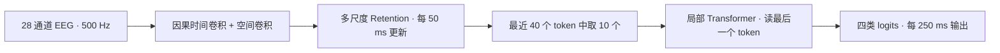

# 下肢运动想象 EEG 解码 · RetNet + Transformer

这个仓库保存 Figshare 开环实验的完整方法组 `A0_full_L10_safe`。一个学生模型接收连续 EEG，逐次输出静止 Idle、运动 Idle、运动 MI、静止 MI 四类 logits。学生包含 **74,868 个可训练参数**。训练时，三个同结构因果教师的置信度和一致性共同决定每个端点的蒸馏强度。在线推理只运行学生。

## 模型怎样读 EEG



| 部分 | 原实验设置 |
|---|---|
| EEG 前端 | 250 点因果时间卷积、28 通道深度空间卷积，每 25 点池化为一个 64 维 token |
| RetNet 风格的 Retention | 4 头，保留全部 token，衰减半衰期分别为 1、2、4、8 秒。跨块传递每头的键值状态 |
| L10 局部 Transformer | 从当前端点往前取 2 秒。在对应的 40 个 token 中选下标 3、7、…、39，保留原位置编码。单层、4 头，FFN 宽度 128，dropout 0.25 |
| 流式端点 | 初始化后第 1000 个样本时首次输出，此后每 125 点输出一次。每个窗口的自注意力只接触该端点及以前的数据 |

Retention 在完整试次内持续累积历史，抽稀只发生在 Transformer 的输入处。跨块传递卷积尾部、Retention 状态和 token 缓存；新 trial 开始时重置状态。[模型实现](eegdecode/model.py)

## K0-safe 可靠性蒸馏

1. 在同一被试的源试次上，用类别加权交叉熵分别训练三个 Hybrid 教师，种子为 9001、9002、9003。K0 表示教师与学生在同一决策端点输出，使用的未来样本数为零。
2. 固定教师，在每个源 trial 上分别回放干净 EEG 和确定性扰动视图。后者在源域标准化后随机置零一个通道，再加 AR(1) 噪声（系数 0.8，标准差 0.05）。同一 trial 的三个教师共享扰动视图。
3. 在温度 1 下，记干净视图的三教师平均概率为 $p$，扰动视图的平均概率为 $p'$。$J_m$ 是三个干净成员分布的广义 Jensen–Shannon 散度，$J_v$ 是 $p$ 和 $p'$ 的 Jensen–Shannon 散度。用自然对数计算每个端点的权重：

   $$r = \operatorname{clip}_{[0,1]}\left[\left(1-\frac{H(p)}{\ln 4}\right)e^{-J_m/0.1} e^{-J_v/0.1}\right].$$

4. 在温度 3 下，对干净视图的三个教师分别做 softmax，再平均为软目标 $q$。给定学生 logits $z$ 和真实标签 $y$，每个有效端点使用：

   $$\ell = (1-0.5r)\,\mathrm{CE}(z,y) + 0.5r\cdot 3^2\,\mathrm{KL}\big(q\parallel\mathrm{softmax}(z/3)\big).$$

   最终按源训练类别逆频率加权平均。$r=0$ 时完全使用真实标签，$r=1$ 时 CE 与温度校正后的 KL 各占一半。训练只使用稳定、已过预热期的端点，按 trial ID 和绝对样本端点匹配教师输出。[权重与损失实现](eegdecode/distillation.py) · [训练入口](eegdecode/train.py)

## 运行

在仓库根目录执行。建议使用 Python 3.11 或更新版本。

```bash
python -m pip install -r requirements.txt
python -m unittest discover -s tests -v
python -m eegdecode.train smoke --out runs/smoke
```

`smoke` 用合成信号跑通三教师训练、双视图回放、学生更新及权重保存。每次运行使用新的输出目录。产出的 `student.pt` 标有 `synthetic=True` 和 `formal_result=False`。

**使用真实 Figshare 源数据**。从原始数据集取得 `Opened_loop.zip`，直接传入压缩包。入口按被试读取 S1/S2 完整试次，先做因果 60 Hz 陷波、1–40 Hz 带通及共平均参考，再用该被试源数据拟合标准化。输入通道顺序及事件映射见数据适配器。原始数据和被试权重由使用者单独管理。[Figshare 数据集](https://doi.org/10.6084/m9.figshare.24083994.v1) · [数据适配器](eegdecode/data.py)

下例用一个 epoch 检查真实数据训练入口。复现实验时，将两个学习率和轮数分别替换为该被试在 S1→S2、S2→S1 开发折上冻结的预算。原方案用三教师集成的类别平衡 NLL 选择教师预算，用 Hybrid CE 参考模型的 conditional BAcc 选择学生预算。仓库实现冻结预算后的源训练阶段。

```bash
python -m eegdecode.train source --archive data/Opened_loop.zip --subject A01 \
  --teacher-epochs 1 --teacher-lr 0.001 --student-epochs 1 --student-lr 0.001 \
  --seed 42 --device cpu --out runs/A01-one-epoch
```

**流式推理**。以下示例使用合成检查点。实际接入时，输入须使用训练时相同的 28 通道、采样率和因果预处理，再应用检查点中的 `source_normalization`。滤波器状态跨同一 trial 的数据块持续传递。`ends` 是从 trial 起点累计的样本数，对应的零基样本位置为 `ends - 1`。

```python
import torch
from eegdecode import Hybrid

checkpoint = torch.load("runs/smoke/student.pt", map_location="cpu", weights_only=True)
model = Hybrid().eval()
model.load_state_dict(checkpoint["weights"])
state = None
with torch.inference_mode():
    for block in torch.zeros(1, 28, 1250).split(125, dim=-1):
        logits, ends, state = model.forward_chunk(block, state)
        for endpoint, scores in zip(ends.tolist(), logits[0]):
            print(endpoint, scores.softmax(-1).tolist())
```

## 实现来源与验证范围

模型和蒸馏公式提取自 2026-11-11 的 `Figshare_SourceOnly_Adapted_20261111` 实验包，对应 `A0_full_L10_safe`、`transformer_token_stride=4`、`teacher_k=0`。模型保留原学生的参数名和张量形状。此处将该组独立为源训练与推理入口，教师在源数据上拟合并为同一批源试次提供目标。原实验另有源内选参、S3/S4 前六试次校准和后八试次评估；这些阶段由原实验包管理。

移植时用相同权重、相同输入对照了原学生输出与状态，并对照了扰动视图、软目标、可靠性和蒸馏损失。单元测试覆盖分块与整段推理一致性、修改未来信号后的端点因果性、可靠性衰减和加权损失。这里报告实现验证；模型准确率与蒸馏增益须由指定评估协议测量。
